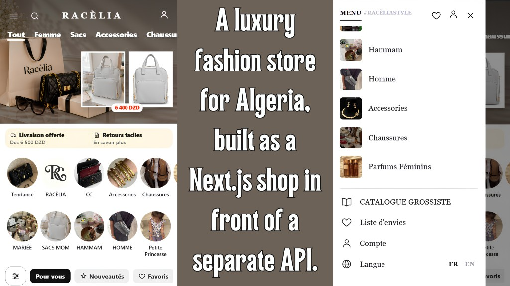

# RACÈLIA



L'ART DU GESTE, collection 2026. Bags, shoes, accessories, fragrance, kids, bridal, and hammam, sold from Algiers to the rest of the country.

The shop you see above is the Next.js storefront. Orders, accounts, and the catalog live on a separate Express API, with MongoDB behind it. Photos sit on Cloudinary. The public site is [racelia.com](https://racelia.com).

## On the floor

- Browse by world: femme, homme, enfants, mariée, hammam, sacs, shoes, parfums, and a wholesale catalogue. Search, product pages, and a wishlist sit next to the grid.
- Fill a bag and check out by wilaya and commune. Pay on delivery, or choose Visa, Mastercard, PayPal, CIB, or Edahabia.
- Prices are stored in dinars and can be shown in DZD, euro, or dollar. The shop speaks French and English.
- An account keeps the profile, past orders, reviews, returns, gift cards, and a loyalty discount at checkout.
- Boutiques, corners, and ateliers are listed on the site and edited from the dashboard.

## Behind the counter

The same API feeds an admin dashboard: products, orders, users, blogs, boutiques, collected emails, reviews, and RACÈLIASTYLE looks.

## How it is built

| | |
| --- | --- |
| Front end | Next.js 16, React 19 |
| Backend | Node.js, Express 5, MongoDB Atlas, Mongoose, JWT |
| Images | Cloudinary |
| Hosting | Vercel. The storefront is racelia.com. The API runs as its own Vercel service. |

## Run the shop

```bash
npm install
npm run dev
```

Open [http://localhost:3000](http://localhost:3000).

Point the storefront at the API with `.env.local`:

```env
NEXT_PUBLIC_API_URL=https://rac-lia-backend-n485.vercel.app
```

The API itself lives in the sibling `Racélia backend` project (Express, MongoDB Atlas, Cloudinary).
